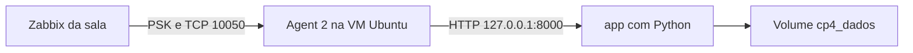

# Monitorizar e testar a aplicação Python Docker no Zabbix

Este guia mostra como criar o host e os itens em **Data collection** no Zabbix 7.0, observar a CP4 e testar alarmes com paragem e recuperação do serviço. Serve para o formador e os formandos, com o mesmo projeto `cp4`, serviço `app`, volume `cp4_dados` e ficheiro `~/cp4/compose.yaml`.

A CP4 publica HTTP em `127.0.0.1:8000` na VM Ubuntu. O **Agent 2 instalado nessa VM** vai fazer os pedidos HTTP e devolver os resultados ao Zabbix da sala pela interface do agente, na porta 10050. Assim, `127.0.0.1` nas chaves dos itens refere-se à VM do posto. [Chaves suportadas pelo Agent 2](https://www.zabbix.com/documentation/7.0/en/manual/config/items/itemtypes/zabbix_agent/zabbix_agent2)



Usa o **PuTTY ligado à VM Ubuntu** para os blocos Bash e o **browser do Windows** para os passos no frontend. Os parâmetros reais e as credenciais são os entregues para o posto.

## 1 Preparar o teste na VM Ubuntu

É necessário ter Docker/Compose, CP4, Agent 2 e `~/parametros-posto.sh` preparados. Se faltar a ficha, conclui a [preparação comum](AMBIENTE_COMUM.md); se faltar a aplicação, segue [PREPARAR_CP4.md](PREPARAR_CP4.md).

Na VM do posto, confirma os serviços e cria um ficheiro dedicado à monitorização dentro do volume. O bloco conserva os restantes dados e só cria o ficheiro quando está em falta:

```bash
source "$HOME/parametros-posto.sh" &&
validar_parametros &&
(
    set -euo pipefail
    sudo docker compose -f "$COMPOSE_CP4" config --quiet
    sudo docker compose -f "$COMPOSE_CP4" up -d app
    systemctl is-active --quiet zabbix-agent2
    sudo docker compose -f "$COMPOSE_CP4" exec -T app sh -c '
        set -eu
        test ! -L /dados/monitorizacao.txt
        if [ ! -e /dados/monitorizacao.txt ]; then
            printf "%s\n" "$1" > /dados/monitorizacao.txt
        fi
        if [ "$(cat /dados/monitorizacao.txt)" != "$1" ]; then
            echo "monitorizacao.txt já existe com outro conteúdo; foi conservado. Rever antes de continuar." >&2
            exit 1
        fi
    ' sh "CP4-OK-$POSTO"
    RESPOSTA=$(curl --retry 10 --retry-connrefused --retry-delay 1 \
        --max-time 5 --fail --silent --show-error \
        "http://127.0.0.1:${PORTA_BACKEND}/monitorizacao.txt")
    [[ "$RESPOSTA" == "CP4-OK-$POSTO" ]]
    printf 'Aplicação: %s\nHost Zabbix: %s\nIP da VM: %s\nFrontend: %s\n' \
        "$RESPOSTA" "$NOME_LOGICO_DO_POSTO" "$IP_VM" "$URL_ZABBIX"
)
```

**Esperado:** `CP4-OK-p1`, `CP4-OK-p2`, `CP4-OK-p3` ou `CP4-OK-formador`, conforme o posto. O HTTP deve responder antes de configurar a recolha.

## 2 Criar ou confirmar o host em Data collection

No browser, entra em `URL_ZABBIX` com a conta que permite configurar o teu host. Em **Data collection → Hosts**, procura primeiro `NOME_LOGICO_DO_POSTO`. Se já existir, abre-o; caso contrário, carrega em **Create host**.

Na aba **Host**, preenche:

| Campo | Valor |
|---|---|
| Host name | Valor exato de `NOME_LOGICO_DO_POSTO`, por exemplo `srv-p1` ou `srv-formador` |
| Host groups | Grupo atribuído em `GRUPO_HOSTS`; pede ao formador para o criar se faltar |
| Templates | `Linux by Zabbix agent`, para as métricas gerais da VM |
| Interfaces → Add → Agent | IP real de `IP_VM`, ligação por IP, porta `10050` |
| Monitored by | Servidor Zabbix da sala, salvo indicação de um proxy |
| Enabled | Ativado |

Na aba **Encryption**, escolhe **PSK** em **Connections to host**, preenche **PSK identity** com `IDENTIFICADOR_PUBLICO` e **PSK** com o segredo desse posto, entregue pelo formador. Guarda com **Add** ou **Update**. A PSK fica no frontend e no agente; não a coloques no GitHub nem em capturas.

Na VM, podes consultar os valores públicos de configuração sem mostrar a PSK:

```bash
source "$HOME/parametros-posto.sh" &&
validar_parametros &&
(
    set -euo pipefail
    printf 'Host: %s\nGrupo: %s\nIP: %s\nIdentidade PSK: %s\n' \
        "$NOME_LOGICO_DO_POSTO" "$GRUPO_HOSTS" "$IP_VM" "$IDENTIFICADOR_PUBLICO"
    sudo grep -E '^(Server|Hostname|TLSAccept|TLSPSKIdentity|TLSPSKFile)=' \
        /etc/zabbix/zabbix_agent2.conf
    sudo ufw allow from "$IP_ZABBIX" to any port 10050 proto tcp
    sudo ufw status numbered
)
```

O endereço da interface **Agent** é o IP da VM do posto. A chave HTTP usará o loopback dessa VM no próximo passo. O estado do agente deve passar a verde com dados recentes. Para resolver erros de PSK ou conectividade, consulta [T12 do guia do formador](formador/GUIA_RESOLUCAO.md#t12--host-no-zabbix).

## 3 Criar os três itens da CP4

Em **Data collection → Hosts**, na linha do host, carrega em **Items → Create item**. Usa **Type = Zabbix agent**, a verificação passiva que é executada pelo agente na VM. [Configuração e teste de itens no Zabbix 7.0](https://www.zabbix.com/documentation/7.0/en/manual/config/items/item)

Os exemplos seguintes usam a porta comum **8000**. Se `PORTA_BACKEND` tiver outro valor, usa esse valor nas três chaves e nas expressões dos triggers.

### Item de disponibilidade

| Campo | Valor |
|---|---|
| Name | `CP4 - Disponibilidade HTTP` |
| Type | `Zabbix agent` |
| Key | `net.tcp.service[http,127.0.0.1,8000]` |
| Host interface | Agent do posto, porta `10050` |
| Type of information | `Numeric (unsigned)` |
| Update interval | `15s` |
| Enabled | Ativado |

Carrega em **Test** no fundo do formulário e depois em **Get value**. Com a aplicação a funcionar, espera `1`. Fecha o teste e grava o item com **Add**. O resultado `0` indica que a verificação do serviço falhou.

### Item de tempo de resposta

Cria outro item no mesmo host:

| Campo | Valor |
|---|---|
| Name | `CP4 - Tempo de resposta HTTP` |
| Type | `Zabbix agent` |
| Key | `net.tcp.service.perf[http,127.0.0.1,8000]` |
| Type of information | `Numeric (float)` |
| Units | `s` |
| Update interval | `15s` |

Usa **Test → Get value** e guarda com **Add**. O valor representa segundos; `0` também pode significar falha do serviço, pelo que deve ser lido em conjunto com a disponibilidade.

### Item de conteúdo

Cria o terceiro item:

| Campo | Valor |
|---|---|
| Name | `CP4 - Conteudo HTTP` |
| Type | `Zabbix agent` |
| Key | `web.page.get[127.0.0.1,/monitorizacao.txt,8000]` |
| Type of information | `Text` |
| Update interval | `15s` |

Em **Test → Get value**, confirma uma resposta que contém `CP4-OK-` seguido do posto. O valor inclui os cabeçalhos HTTP e o corpo. Guarda com **Add**. A disponibilidade verifica o serviço; este item permite conferir a resposta da aplicação. [Significado das chaves HTTP](https://www.zabbix.com/documentation/7.0/en/manual/config/items/itemtypes/zabbix_agent#net.tcp.service)

Se uma chave já existir no host, edita o item existente. As chaves são únicas por host. Podes acrescentar a tag `application=cp4` aos três itens para facilitar a filtragem.

## 4 Confirmar a recolha em Latest data

Abre **Monitoring → Latest data**, filtra pelo host e por `CP4`, e carrega em **Apply**. Aguarda as primeiras recolhas; se necessário, seleciona os itens passivos em Data collection e usa **Execute now**.

| Item | Resultado saudável |
|---|---|
| Disponibilidade HTTP | `1` e instante recente |
| Tempo de resposta HTTP | Valor em segundos, com gráfico disponível |
| Conteudo HTTP | Cabeçalhos e marcador `CP4-OK-POSTO` |

Confirma **Last check**, **Last value** e, nos itens numéricos, **Graph**. Um valor antigo não comprova que a aplicação continua disponível. O teste pontual no formulário deve ser seguido desta confirmação da recolha normal.

## 5 Criar os triggers

Na VM Ubuntu, gera as expressões com o nome real do host e o marcador do posto:

```bash
source "$HOME/parametros-posto.sh" &&
validar_parametros &&
{
    printf 'Trigger disponibilidade:\nlast(/%s/net.tcp.service[http,127.0.0.1,%s])=0\n\n' \
        "$NOME_LOGICO_DO_POSTO" "$PORTA_BACKEND"
    printf 'Trigger conteúdo:\nfind(/%s/web.page.get[127.0.0.1,/monitorizacao.txt,%s],,"like","CP4-OK-%s")=0\n' \
        "$NOME_LOGICO_DO_POSTO" "$PORTA_BACKEND" "$POSTO"
}
```

No browser, vai a **Data collection → Hosts → Triggers → Create trigger**. Cria dois triggers, usando as expressões impressas no terminal:

| Campo | Disponibilidade | Conteúdo |
|---|---|---|
| Name | `CP4 - HTTP indisponivel` | `CP4 - Conteudo inesperado` |
| Severity | `Average` | `Warning` |
| Expression | Expressão de disponibilidade | Expressão de conteúdo |
| OK event generation | `Expression` | `Expression` |
| Enabled | Ativado | Ativado |

Grava ambos. Com dados saudáveis, as expressões devem estar falsas e os triggers em **OK**. A função `find` procura o marcador no valor mais recente. [Funções de histórico](https://www.zabbix.com/documentation/7.0/en/manual/appendix/functions/history#find)

O trigger de disponibilidade reage a um valor novo igual a `0`. Se o próprio agente ou a VM deixarem de responder, pode não chegar um valor novo; esse caso exige também observar a disponibilidade do agente e os respetivos alarmes do template Linux.

## 6 Testar a paragem e a recuperação do contentor

Na VM Ubuntu, para apenas o serviço `app`:

```bash
source "$HOME/parametros-posto.sh" &&
validar_parametros &&
(
    set -euo pipefail
    date --iso-8601=seconds
    sudo docker compose -f "$COMPOSE_CP4" stop app
    sudo -u zabbix zabbix_agent2 -c /etc/zabbix/zabbix_agent2.conf \
        -t "net.tcp.service[http,127.0.0.1,${PORTA_BACKEND}]"
)
```

O teste local deve devolver valor `0`. Em **Latest data**, aguarda uma nova amostra igual a `0`; em **Monitoring → Problems**, deve surgir `CP4 - HTTP indisponivel`. A recolha foi configurada a cada 15 segundos, mas a primeira execução e a atualização do frontend podem demorar mais. O item de conteúdo pode ficar **Not supported** enquanto o HTTP estiver inacessível.

Depois de registar o evento, repõe o serviço na VM:

```bash
source "$HOME/parametros-posto.sh" &&
validar_parametros &&
(
    set -euo pipefail
    sudo docker compose -f "$COMPOSE_CP4" up -d app
    RESPOSTA=$(curl --retry 10 --retry-connrefused --retry-delay 1 \
        --max-time 5 --fail --silent --show-error \
        "http://127.0.0.1:${PORTA_BACKEND}/monitorizacao.txt")
    [[ "$RESPOSTA" == "CP4-OK-$POSTO" ]]
    printf '%s\n' "$RESPOSTA"
    date --iso-8601=seconds
)
```

Confirma disponibilidade `1`, conteúdo correto e evento **RESOLVED** após a nova recolha. Em **Monitoring → Problems**, usa **Show = Recent problems** ou **History** para consultar o evento recuperado. O marcador continua no volume depois de voltar a iniciar o contentor. [Consulta de problemas e histórico](https://www.zabbix.com/documentation/7.0/en/manual/web_interface/frontend_sections/monitoring/problems)

## 7 Testar uma resposta HTTP com conteúdo errado

Este ensaio altera apenas `monitorizacao.txt`. A aplicação continua a responder, permitindo verificar o trigger de conteúdo. Na VM Ubuntu:

```bash
source "$HOME/parametros-posto.sh" &&
validar_parametros &&
(
    set -euo pipefail
    sudo docker compose -f "$COMPOSE_CP4" exec -T app sh -c '
        set -eu
        test ! -L /dados/monitorizacao.txt
        test "$(cat /dados/monitorizacao.txt)" = "$1"
        test ! -e /dados/monitorizacao.txt.antes-teste
        test ! -L /dados/monitorizacao.txt.antes-teste
        cp -p /dados/monitorizacao.txt /dados/monitorizacao.txt.antes-teste
        printf "%s\n" "CP4-ENSAIO-FALHA" > /dados/monitorizacao.txt
    ' sh "CP4-OK-$POSTO"
    curl --fail --silent --show-error \
        "http://127.0.0.1:${PORTA_BACKEND}/monitorizacao.txt"
)
```

Em **Latest data**, a disponibilidade mantém-se `1`, mas o conteúdo passa a incluir `CP4-ENSAIO-FALHA`. Depois da recolha, espera o problema `CP4 - Conteudo inesperado`.

Repõe o conteúdo original:

```bash
source "$HOME/parametros-posto.sh" &&
validar_parametros &&
(
    set -euo pipefail
    sudo docker compose -f "$COMPOSE_CP4" exec -T app sh -c '
        set -eu
        test ! -L /dados/monitorizacao.txt
        test ! -L /dados/monitorizacao.txt.antes-teste
        test -s /dados/monitorizacao.txt.antes-teste
        test "$(cat /dados/monitorizacao.txt.antes-teste)" = "$1"
        cp -p /dados/monitorizacao.txt.antes-teste /dados/monitorizacao.txt
        rm -- /dados/monitorizacao.txt.antes-teste
    ' sh "CP4-OK-$POSTO"
    RESPOSTA=$(curl --fail --silent --show-error \
        "http://127.0.0.1:${PORTA_BACKEND}/monitorizacao.txt")
    [[ "$RESPOSTA" == "CP4-OK-$POSTO" ]]
    printf '%s\n' "$RESPOSTA"
)
```

Confirma a recuperação do trigger depois de chegar o conteúdo correto. Regista a diferença entre um serviço que responde e uma aplicação que devolve a resposta esperada.

## 8 Acrescentar métricas do Docker

Esta extensão permite observar o motor Docker e os recursos dos contentores. Usa o template oficial **Docker by Zabbix agent 2**, da versão 7.0. [Configuração do template](https://github.com/zabbix/zabbix/blob/release/7.0/templates/app/docker/README.md)

O formador pode dar à conta do agente acesso ao socket Docker na VM do laboratório. A pertença ao grupo `docker` concede capacidades equivalentes a root sobre o anfitrião, pelo que esta alteração deve ser uma decisão da preparação do laboratório. [Permissões do grupo Docker](https://docs.docker.com/engine/install/linux-postinstall/)

Na VM Ubuntu:

```bash
(
    set -euo pipefail
    getent group docker
    sudo usermod -aG docker zabbix
    sudo systemctl restart zabbix-agent2
    sudo -u zabbix zabbix_agent2 -c /etc/zabbix/zabbix_agent2.conf -t docker.ping
)
```

Espera valor `1` no teste. No frontend:

1. Abre o host em **Data collection → Hosts**.
2. Em **Templates**, acrescenta **Docker by Zabbix agent 2**, conservando o template Linux e os itens CP4.
3. Guarda com **Update**.
4. Aguarda a descoberta dos contentores e consulta **Monitoring → Latest data**.
5. Filtra por `Docker` e pelo nome real do contentor, normalmente `cp4-app-1`. Confirma dados recentes de estado, CPU, memória e rede.

Se o template não estiver disponível, o formador deve importar a versão 7.0 indicada na referência. Se aparecer `permission denied` no socket, confirma a pertença ao grupo e o reinício do serviço. A recolha HTTP dos passos anteriores funciona através do acesso à porta local e não exige acesso ao socket Docker.

## 9 Resolver os erros mais comuns

| Sintoma | Verificação |
|---|---|
| Falta `parametros-posto.sh` | Concluir a preparação comum na VM Ubuntu |
| `no container found for service` | Usar o Compose de `~/cp4` e o serviço `app`; confirmar `up -d app` |
| Agent vermelho ou teste com timeout | IP da interface Agent, porta 10050, regra UFW, `Server`, PSK e identidade do posto |
| Item testa o Zabbix em vez da aplicação | Confirmar **Type = Zabbix agent** e a interface da VM do posto |
| Conteúdo saudável com HTTP indisponível | Ver se é um valor antigo; confirmar `Last check` e a nova recolha |
| `Not supported` no conteúdo com app parada | Recuperar `app`; aguardar a leitura da página quando voltar a responder |
| Expressão de trigger recusada | Usar o nome técnico exato de **Host name**, a chave do item e a porta correta |
| Docker sem métricas | Verificar `docker.ping`, permissões do socket e descoberta do template |

Para testar localmente o conteúdo através da conta do agente:

```bash
source "$HOME/parametros-posto.sh" &&
validar_parametros &&
sudo -u zabbix zabbix_agent2 -c /etc/zabbix/zabbix_agent2.conf \
    -t "web.page.get[127.0.0.1,/monitorizacao.txt,${PORTA_BACKEND}]"
```

Este teste local confirma a execução da chave. **Test → Get value** no frontend e os valores recentes em **Latest data** confirmam também a recolha através do servidor/proxy.

## 10 Registar o resultado

- Host, posto e nome do contentor identificados.
- Três itens CP4 com valores recentes.
- Dois triggers criados e saudáveis antes dos ensaios.
- Paragem de `app`: disponibilidade `0`, problema aberto e recuperação para `1`.
- Conteúdo errado: HTTP continua disponível, problema de conteúdo aberto e recuperado.
- Aplicação e conteúdo restaurados no final, com dados do volume conservados.

Este complemento trata a aplicação Python diretamente pelo Agent 2. O cenário web do site publicado com Nginx/HTTPS continua no [T13 do guia](formador/GUIA_RESOLUCAO.md#t13--cenário-https-e-triggers), incluindo a resolução do nome e a confiança na CA a partir do servidor Zabbix.
